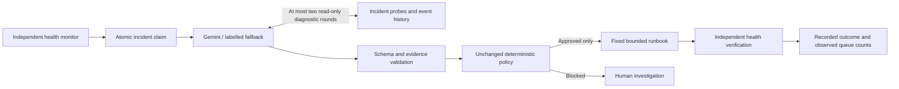

# Demo Studio: attendance-first judge walkthrough

The Studio pairs a simulated student workspace with an independent monitor. Requests use the isolated child service; they never increment health counters or resolve incidents. No real university systems are connected.

## Attendance-first 90-second demonstration

Before presenting, run `python start.py`, click **Start local demo**, reset any prior run, and wait until **Run demonstration** is enabled. Attendance is selected by default. Rehearse at 1366 x 768 or larger with technical disclosures closed. Do not spend presentation time installing or starting services.

| Time | Show and say |
| --- | --- |
| 0-10 s | "Attendance records can get stuck waiting to sync. Rebound demonstrates one approved recovery and checks the result. These are synthetic records." |
| 10-20 s | Click **Run demonstration**, then **Confirm scenario**. "Twelve records are now queued. This request shows the failure; a separate monitor detects it." |
| 20-40 s | Follow the recorded failure, analysis and safety-policy entries in the activity feed. "Rebound allows a fixed queue replay only when evidence matches. Analysis cannot override that rule." Read the recorded assessment, recommended predefined action and independent policy verdict. Name the actual provider displayed; fallback is not live Gemini. |
| 40-60 s | Wait for **Queue replayed. Recovery verified.** and the observed counts: **12 pending at failure / 12 processed / 0 remaining**. "The queue was processed without restarting the service. Independent health checks verified recovery." Quote only the displayed time, measured from incident detection. |
| 60-70 s | Open **Technical details** for **Print incident summary** and **Export evidence**. "The result and supporting evidence remain available for review." |
| 70-85 s | Show the saved registration safety-stop screenshot. "For this simulated database fault, there is no approved remedy. Rebound records the evidence and stops without restarting." Identify it as a completed test capture, not a second live run. |
| 85-90 s | "Rebound automates a known recovery task and makes its safety boundary visible." |

These times are speaking guidance, not promised execution durations. Default checks run every five seconds; live Gemini can add latency. If a result takes longer, show the actual pending state. Do not imply completion or reset to manufacture success. Use a clearly labelled saved result if the live stack is unavailable.

## Follow-up stories and evidence

For a live safety stop outside the 90-second slot: select **Registration hits database contention** in **Change scenario**, click **Run selected scenario**, then **Confirm replay**. Wait for **Automatic recovery safely blocked**. The registration request returns HTTP 500 and no recovery execution is recorded. Reset closes the incident administratively; it is not recovery.

Portal crash/restart remains available in **Change scenario**. Select **The learning portal goes offline** and run it. A real child process stops and is restarted once; independent probes verify health. Course content is illustrative, not retrieved from a university portal.

**Technical details** opens the recorded workflow, analysis, policy decision, process counters, probe receipts and event timeline. Within that area, **Recovery execution details** contains the raw execution receipt and process observations. Disclosures do not affect backend processing. Provider provenance stays visible in the main outcome.

## Final screenshots

Captures are generated by isolated live Chromium tests, not mocked progress. Keyless runs show deterministic fallback. Test checks run every two seconds; normal startup uses five seconds. Capture timings are examples, not performance promises.

- [Attendance ready](screenshots/studio-attendance-ready.png)
- [Attendance failure detected](screenshots/studio-attendance-detection.png)
- [Attendance verified](screenshots/studio-attendance-verified.png)
- [Expanded technical evidence](screenshots/studio-attendance-evidence.png)
- [Attendance mobile](screenshots/studio-attendance-mobile.png)
- [Registration safety stop](screenshots/studio-human-review-dark.png)
- [Portal recovery](screenshots/studio-crash-verified.png)
- [Disconnected backend](screenshots/studio-disconnected.png)
- [Printable incident report](screenshots/incident-print-summary.png)

## Verification

Run Python regression tests from the repository root:

```powershell
.\.venv\Scripts\python.exe -m pytest tests/ -q
```

From `apps/web`, run these sequentially. Next.js development tests and builds both generate type references; do not run the production build concurrently with the browser server.

```powershell
npm run check
npm run format:check
npm run test:e2e
npm run build
```

Playwright starts an isolated API, monitor, supervisor, workload and web server on ports 3101, 8101, 5107 and 5108, with a temporary database and no live AI credentials. Install Chromium with `npx playwright install chromium` if necessary. Tests cover all three stories, replay/reset, JSON export, print-media output, disconnection, event delivery, mobile layout and reduced motion.

## Honest limits

- One synthetic workload; the attendance queue is in memory, not durable student-record storage.
- Student-request queue counts and independent health verification are separate observations.
- Gemini API is labelled only after an actual provider result. Gemini Enterprise transport is not implemented.
- Request receipts live in browser memory. Server incident history persists, but reloading cannot recreate missing student requests.
- Probe samples are bounded; missing observations remain **Not observed**. Runtime observations can be newer than an incident.
- Email delivery, production ticketing, real student accounts and university connectors are absent.
- Chromium emulation and print media are automated; native printer dialogs and physical devices require manual checks.

## Validation for this presentation update

58 Python tests passed. The browser suite includes the existing journeys plus three consecutive attendance recoveries in one test. Desktop attendance, expanded evidence, mobile attendance and the dark safety-stop capture were visually inspected. No backend files or policies changed. Live Gemini and native print dialogs were not exercised.

Stop any running standalone server before rebuilding its `.next-production` output directory. The normal build and the presentation tests should also run sequentially.

The main panel now exposes the recorded analysis summary and recommended action alongside the deterministic policy verdict. Provider labels are driven by stored results, never credential presence. Request timing measurements and raw evidence remain expandable. Three consecutive attendance runs are exercised by the browser suite; their recorded incidents, executions and verification events are saved in [three-attendance-runs.json](three-attendance-runs.json). Viewport captures: [run 1](screenshots/studio-attendance-run-1.png), [run 2](screenshots/studio-attendance-run-2.png), [run 3](screenshots/studio-attendance-run-3.png). These use a two-second test polling interval and deterministic fallback; they are not production performance promises.

The three recorded attendance runs each resolved a distinct incident with one successful queue replay, twelve processed records, zero remaining, two successful verification events and no process restart. Viewport assertions check that the observed result counts fit within 1366 x 768 after focusing the workspace. Gemini-rendering fixtures test provider presentation only; live Gemini was not exercised because this environment has no configured key.

Final checks: 58 Python tests and all nine Chromium tests passed; `npm run check`, `npm run format:check`, and `npm run build` passed. Backend thresholds, policies, runbooks and incident lifecycle were unchanged.

## Minimal presentation comparison

Before captures are preserved from merged PR #6; after captures come from the live browser tests for this update. These are layout comparisons, not timing benchmarks.

| View | Before | After |
| --- | --- | --- |
| Attendance result | [Before](before-minimal/studio-attendance-verified.png) | [After](screenshots/studio-attendance-verified.png) |
| Mobile attendance | [Before](before-minimal/studio-attendance-mobile.png) | [After](screenshots/studio-attendance-mobile.png) |
| Human review | [Before](before-minimal/studio-human-review-dark.png) | [After](screenshots/studio-human-review-dark.png) |

Use **Change scenario** to select any of the three existing stories. After a completed run, **Replay demo** repeats it; selecting a different story changes that button to **Run selected scenario**. **Reset sandbox** remains the only secondary run control. Student requests, measurements, print, export, execution receipts and history are all inside **Technical details**. Missing observations, stale updates and human-review states remain explicit.

Cleanup validation: 58 Python tests, all nine Chromium tests, frontend checks, formatting and the production build passed. Browser assertions cover one replay/reset control, hidden engineering evidence, native scenario selection on mobile, attendance counts, safe refusal and disconnected states. Desktop 1366 x 768, mobile 390px and dark refusal captures were visually inspected. Backend thresholds, policies, runbooks and incident lifecycle were not changed.

## Recorded operations console

The backend status stays current above the console. The feed shows only committed incident events, in sequence order, with actual timestamps. New demonstrations use a labelled guided presentation at 1.7 seconds per available entry; backend processing is never delayed. If evidence has not arrived, the console waits instead of inventing a stage.

**Pause / Resume presentation** affects only the feed. **Skip to latest** shows the available committed history immediately. **Replay recorded activity** replays evidence after completion; the separate **Replay demo** button starts a new fault scenario. A completed incident opened later shows its current recorded outcome immediately. Counts still require a genuine verification-completed event and actual student-request receipts; a reload can show **Not observed** because request receipts live in browser memory.

Disconnection pauses the presentation and displays a warning. Resume explicitly after fresh evidence returns. Missing event sequences are disclosed, duplicates are removed, and delayed entries are inserted in recorded order. Reduced motion disables entry/wait animations and displays available evidence without paced delays. Keyboard users can focus and scroll the internal feed. Rows are not live-announced; backend status and explicit availability warnings carry announcements.

### Live console captures and recording

These are actual isolated-stack attendance and registration runs using labelled deterministic fallback, not scripted fake responses. The existing two-second test health cadence differs from normal five-second startup settings. The separate controlled-clock test uses recorded evidence to test playback controls; it is not the delivered recording.

1. [Initial state](screenshots/console-initial.png)
2. [Failure detected](screenshots/console-failure.png)
3. [Analysis and policy](screenshots/console-analysis-policy.png)
4. [Recovery execution](screenshots/console-recovery.png)
5. [Verification checks](screenshots/console-verification.png)
6. [Verified attendance result](screenshots/console-success.png)
7. [Human-review refusal](screenshots/console-human-review.png)

[Browser recording: attendance and safe refusal](recordings/operations-console.webm). [Mobile console](screenshots/console-mobile.png).

Console validation: 58 Python tests, all 11 Chromium tests, frontend checks, formatting, and the production build passed. Coverage includes real attendance/refusal, initial completed outcomes, controlled pacing, pause/resume, skip/replay, stale evidence, reduced motion, ordering/deduplication, history gaps and missing verification. Semantic colors meet 4.5:1 contrast against the light and dark surfaces. Default presentation remains dark; theme-aware tokens also support the light palette. No backend, monitoring, runbook, policy or event-delivery code changed.

## Judging evidence and 120-second capture

| Time | Screen / narration |
| --- | --- |
| 0-15 s | Attendance ready. "Campus IT repeatedly investigates stalled services. Rebound is our Intelligent Automation & Digital Transformation prototype. Everything here is synthetic." |
| 15-30 s | Open AI investigation details on a prior recorded run. "Gemini can request incident-scoped probes and history. Its versioned instructions treat logs as data. A separate policy alone authorizes recovery." Name the actual provider. |
| 30-75 s | Run attendance, confirm, follow the recorded feed. "This request failed; the independent monitor detected it. Here is the recorded assessment, policy approval and bounded queue replay." Wait for actual counts and verification. "These observations show the pending, processed and remaining records. Two independent health checks confirm recovery." Read actual values; do not speak expected values before observing them. |
| 75-95 s | Select registration contention, run and confirm. "There is no approved recovery for this fault. Human investigation is required. Refusing an unsafe restart preserves the safety boundary." If still pending, say so; a clearly labelled saved capture can be used in a time-limited pitch. |
| 95-120 s | Expand AI investigation details / Technical details. "The trace records actual tool calls and evidence, not generated reasoning. This prototype automates a known operational task. Real adoption needs approved service integrations and runbooks, access control and operational validation. We have not measured savings." |

**Provider wording:** In the locally recorded evidence, say "Deterministic fallback; a live Gemini request was not demonstrated because local credentials were unavailable." Only replace that sentence after a genuine configured-provider run is recorded. A mock, model-availability lookup, or deployed key alone does not establish successful inference. Gemini Enterprise is not integrated.

**Exact capture procedure:** Start the stack and sign in before recording; use 1366x768. Reset and wait for a healthy baseline. Start screen recording, narrate the table above, and let real results complete. Open **AI investigation details** to inspect provider, prompt purpose/version, supplied evidence, actual tool results, recommendation, independent policy and verification. Use **Technical details / Export evidence** for the JSON. Record registration separately if it exceeds the slot; label any edited or previously captured segment. Never accelerate a pending result into a claimed success. Run `npm run test:e2e` in `apps/web` to regenerate live local screenshots and the Playwright video; that run deliberately disables Gemini credentials for repeatability.



| Criterion | Weight | Implemented evidence / honest boundary |
| --- | --- | --- |
| Problem value | 15% | Repetitive campus IT investigation and known recovery; synthetic workload only. |
| User interface | 10% | Attendance-first controls, chronological evidence, mobile layout, advanced detail disclosures. |
| Agentic workflow | 20% | Model-selected read-only tools, bounded rounds, recorded tool results; live Gemini still needs credentialed verification. |
| Prompting and orchestration | 20% | Versioned untrusted-data prompt, structured output, evidence/action validation, independent authorization; deterministic provider tests. |
| App output | 15% | Actual queue observations, one replay, unchanged process, independent probes; refusal has no recovery claim. |
| Business value | 10% | Known operational work automated with auditable intervention; savings and institutional impact unmeasured. |
| Presentation | 10% | 120-second narration, raw live local recording and screenshots, provider disclosure. |

The rubric is supplied by the team; this mapping does not predict judging scores. Existing application monitoring and synthetic tests can cover detection/verification. Rebound's prototype contribution is the visible combination of evidence gathering, a bounded recommendation, deterministic authorization and an auditable recovery outcome. It does not prove superiority over a mature operations platform.

### Final validation artifacts

- [AI investigation disclosure (local fallback)](screenshots/ai-investigation-details.png)
- [Hosted operator sign-in (deployed main)](screenshots/hosted-judge-access.png) and [recorded sign-in result](hosted-access-result.json)
- [Attendance verified](screenshots/console-success.png), [safe refusal](screenshots/console-human-review.png), [mobile](screenshots/console-mobile.png)
- [Raw local attendance + refusal recording](recordings/operations-console.webm): an automated browser capture, without narration; **deterministic fallback**, not a Gemini demonstration.
- [Three consecutive attendance runs](three-attendance-runs.json): persisted synthetic incident, queue, process and verification evidence from the complete browser suite.

Validation on 2026-11-13: 79 Python tests passed on SQLite; the same 79 passed on isolated PostgreSQL 16. TypeScript/UI assertions, formatting and production build passed. The full 11-test Playwright suite passed, including three consecutive attendance recoveries and mobile/refusal checks; the two console tests were rerun after placing the AI disclosure below the observed result. Hosted main sign-in returned HTTP 200 and OPERATOR. No live Gemini inference was attempted because local credentials were absent; provider tests use mocks.

The first cold-start regression exposed a fixed-sleep readiness assumption in the supervisor test; it now waits for an actual healthy response within a bounded deadline. A PostgreSQL rerun initially reused a database containing an obsolete test-service address; the passing run used a freshly initialized isolated test schema. No thresholds, policy decisions or runbook behavior were changed to make these checks pass.
